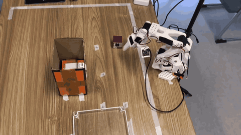
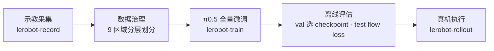

<h1 align="center">π0.5 双视角机械臂抓取与受限开口放置</h1>

<p align="center">
  <b>基于 SO-ARM101 + LeRobot + π0.5 全量微调的真机 VLA 操作</b><br>
  <sub>示教采集 · 数据治理 · π0.5 全量微调 · 离线评估 · 真机执行</sub>
</p>

<p align="center">
  
  <a href="https://github.com/huggingface/lerobot/tree/e0d50211ef236143ae867228662b7dfaba554f02"></a>
  
  
  
</p>

<details>
<summary>目录</summary>

- [结果](#结果)
- [系统组成](#系统组成)
- [方法](#方法)
- [环境](#环境)
- [复现](#复现)
  - [1. 机械臂与相机准备](#1-机械臂与相机准备)
  - [2. 示教采集](#2-示教采集)
  - [3. 划分数据集](#3-划分数据集)
  - [4. 训练](#4-训练)
  - [5. 选择 checkpoint 与离线评估](#5-选择-checkpoint-与离线评估)
  - [6. 真机执行](#6-真机执行)
- [仓库结构](#仓库结构)
- [致谢](#致谢)

</details>

<p align="center">
  
</p>

<p align="center"><i>真机执行演示（4 倍速）。原速带声音的完整视频见 <a href="assets/demo.mp4">assets/demo.mp4</a>。</i></p>

机械臂从桌面随机位置抓取方块，穿过固定盒体的**侧向开口**放入盒内。策略输入为臂载 RGB 与工作台 RGB 双视角，基于 `lerobot/pi05_base` 全参数微调，部署使用 LeRobot 官方 `lerobot-rollout`。



## 结果

**真机 20 次测试成功 17 次，成功率 85%。**

| 阶段 | 成功 / 进入该阶段 |
| --- | ---: |
| 抓取 | 17 / 20 |
| 搬运 | 17 / 17 |
| 放置（穿过侧开口并释放） | 17 / 17 |

3 次失败均发生在抓取阶段：

| 失败原因 | 次数 |
| --- | ---: |
| 调整抓取姿态时末端位置过低，将方块推出可及范围 | 2 |
| 方块紧贴机械臂放置，机械臂无法弯曲到可抓取姿态 | 1 |

判定规则：方块被抓起、穿过侧开口放入盒内、夹爪释放后机械臂撤离，记为成功。机械臂撞击工作台或盒体、方块被推出可及范围时，人工打断并记为失败。

离线测试：部署模型在 25 条测试 episode 全部 10,943 帧上的 teacher-forced flow loss 均值为 0.0339（[results/test_flow_loss.json](results/test_flow_loss.json)）。

## 系统组成

| 项目 | 配置 |
| --- | --- |
| 机械臂 | SO-ARM101，leader 臂遥操作采集，follower 臂执行 |
| 臂载相机 `front` | RGB 相机，640×480 @ 30 fps |
| 工作台相机 `side` | Orbbec Astra Pro，仅使用 RGB，640×480 @ 30 fps |
| 目标物 | 方块，边长 41 mm |
| 盒体侧开口 | 净宽 80 mm、净高 55 mm，盒体位置固定 |
| 训练 GPU | 1 × NVIDIA A100 80GB |
| 部署 GPU | NVIDIA GeForce RTX 5070 Ti Laptop GPU（12 GB） |

任务指令（训练与部署一致）：

```text
Pick up the block, move it through the side opening of the box, release it inside the box, and safely withdraw the gripper.
```

## 方法

### 数据

- 遥操作采集有效示教 **119 条、53,245 帧**，LeRobot v3.0 格式，30 Hz。
- 观测：两路 RGB（640×480，进入模型时等比例缩放并补边到 224×224）+ 6 维关节状态；动作：6 维绝对关节位置目标（shoulder_pan、shoulder_lift、elbow_flex、wrist_flex、wrist_roll、gripper）。
- 划分：按 `side` 相机起始画面中方块位置划分 9 个区域，区域内分层随机，以完整 episode 为单位，随机种子 42，得到 train / val / test = **75 / 19 / 25** 条（33,191 / 9,111 / 10,943 帧）。划分清单见 [configs/split.json](configs/split.json)。
- 归一化：state / action 使用 QUANTILES，统计量只来自训练集，随 checkpoint 预处理器保存，验证、测试、部署共用。

数据治理细节见 [docs/data_pipeline.md](docs/data_pipeline.md)。

### 模型与训练

- 基座：`lerobot/pi05_base`（PaliGemma 2B VLM + Gemma 300M action expert），**全参数微调**，视觉编码器不冻结。
- 相机映射：`side` → `base_0_rgb`，`front` → `left_wrist_0_rgb`；第三路 `right_wrist_0_rgb` 无实体相机，由预处理补空并 mask。训练、评估、部署使用同一映射。

| 参数 | 值 |
| --- | --- |
| batch size | 32 |
| 学习率 | 2.5e-5，AdamW（β=0.9/0.95，weight decay 0.01），1,000 步 warmup + cosine 衰减到 2.5e-6 |
| 训练步数 | 10,000，每 2,000 步保存 |
| 精度 / 显存 | BF16 + 梯度检查点，峰值显存 70.56 GB |
| EMA | decay 0.99 |
| 图像增强 | 亮度、对比度、饱和度、色调、锐度抖动，±5° 旋转，5% 平移 |
| 动作片段 | chunk_size 50，flow matching 10 步去噪 |

checkpoint 选择：对 002000–010000 共 5 个 EMA checkpoint 计算验证集 flow loss，选最低的 **002000 EMA** 部署；测试集只用于最终离线评估。完整训练配置见 [configs/train_config.json](configs/train_config.json)。

### 真机部署

使用 LeRobot 官方 `lerobot-rollout`（episodic 策略、同步推理）在本机 GPU 上直接推理，30 Hz 下发关节目标。每次推理生成 50 步动作片段，执行完整个片段后再推理下一段。单次运行不设时间上限，由操作者按键结束，两次之间留 3 秒复位。

## 环境

| 组件 | 版本 |
| --- | --- |
| OS | Ubuntu 22.04 |
| Python | 3.12 |
| PyTorch | 2.7.1 + CUDA 12.8 |
| LeRobot | 0.6.2（提交 `e0d50211ef236143ae867228662b7dfaba554f02`） |
| FFmpeg | 7.1（视频解码） |

一键安装：

```bash
conda create -n pi05 python=3.12 -y
conda activate pi05
conda install -c conda-forge ffmpeg=7.1 -y
pip install -r requirements.txt
```

π0.5 使用 PaliGemma tokenizer（`google/paligemma-3b-pt-224`，需在 Hugging Face 页面同意许可）。首次训练前登录：

```bash
hf auth login
```

## 复现

以下命令中 `<...>` 按本机设备填写。

### 1. 机械臂与相机准备

按 LeRobot 官方 SO-101 流程完成端口识别、舵机设置与标定：

```bash
lerobot-find-port
lerobot-setup-motors --robot.type=so101_follower --robot.port=<follower_port>
lerobot-setup-motors --teleop.type=so101_leader --teleop.port=<leader_port>
lerobot-calibrate --robot.type=so101_follower --robot.port=<follower_port> --robot.id=<follower_id>
lerobot-calibrate --teleop.type=so101_leader --teleop.port=<leader_port> --teleop.id=<leader_id>
lerobot-find-cameras opencv
```

### 2. 示教采集

```bash
lerobot-record \
  --robot.type=so101_follower \
  --robot.port=<follower_port> \
  --robot.id=<follower_id> \
  --robot.cameras='{front: {type: opencv, index_or_path: 0, width: 640, height: 480, fps: 30, fourcc: "YUYV"}, side: {type: opencv, index_or_path: 2, width: 640, height: 480, fps: 30, fourcc: "MJPG"}}' \
  --teleop.type=so101_leader \
  --teleop.port=<leader_port> \
  --teleop.id=<leader_id> \
  --dataset.repo_id=<hf_user>/pi05_block_sidebox \
  --dataset.root=datasets/pi05_block_sidebox \
  --dataset.single_task="Pick up the block, move it through the side opening of the box, release it inside the box, and safely withdraw the gripper." \
  --dataset.fps=30 \
  --dataset.num_episodes=<num_episodes> \
  --dataset.push_to_hub=false \
  --display_data=true
```

### 3. 划分数据集

用官方 `lerobot-edit-dataset` 按完整 episode 划分。本项目的划分清单在 `configs/split.json` 的 `splits` 字段：

```bash
lerobot-edit-dataset \
  --repo_id=<hf_user>/pi05_block_sidebox \
  --root=datasets/pi05_block_sidebox \
  --new_root=datasets/pi05_block_sidebox_splits \
  --operation.type=split \
  --operation.splits="$(python -c 'import json;print(json.dumps(json.load(open("configs/split.json"))["splits"]))')"
```

输出 `datasets/pi05_block_sidebox_splits/{train,val,test}`。训练只加载 `train`，统计量由训练集计算。

### 4. 训练

```bash
lerobot-train \
  --dataset.repo_id=local/pi05_sidebox_train \
  --dataset.root=datasets/pi05_block_sidebox_splits/train \
  --dataset.eval_split=0 \
  --dataset.use_imagenet_stats=false \
  --dataset.video_backend=torchcodec \
  --dataset.image_transforms.enable=true \
  --policy.path=lerobot/pi05_base \
  --policy.device=cuda \
  --policy.dtype=bfloat16 \
  --policy.gradient_checkpointing=true \
  --policy.push_to_hub=false \
  --rename_map='{"observation.images.side": "observation.images.base_0_rgb", "observation.images.front": "observation.images.left_wrist_0_rgb"}' \
  --accelerator.mixed_precision=bf16 \
  --batch_size=32 \
  --num_workers=4 \
  --dataloader_multiprocessing_context=spawn \
  --steps=10000 \
  --save_checkpoint=true \
  --save_freq=2000 \
  --log_freq=100 \
  --eval_steps=0 \
  --env_eval_freq=0 \
  --ema.enable=true \
  --ema.decay=0.99 \
  --wandb.enable=false \
  --job_name=pi05_sidebox \
  --output_dir=outputs/pi05_sidebox
```

batch 32 全量微调需要约 71 GB 显存（A100 80GB）。`scripts/run_pi05_train_eval.py` 是训练服务器上串联训练与 checkpoint 验证的原始脚本，使用前把脚本中的 `ROOT`（占位路径 `/path/to/workdir`）改为实际工作目录。`configs/` 中的路径同为占位路径。

### 5. 选择 checkpoint 与离线评估

`scripts/eval_pi05_checkpoints.py` 使用 LeRobot 官方数据加载与训练预处理，计算 teacher-forced flow loss，归一化使用 checkpoint 保存的统计量。

在验证集上比较各 checkpoint（每条 episode 取 2 帧，共 38 帧）：

```bash
for step in 002000 004000 006000 008000 010000; do
  python scripts/eval_pi05_checkpoints.py \
    --checkpoint outputs/pi05_sidebox/checkpoints/$step/pretrained_model_ema \
    --val-root datasets/pi05_block_sidebox_splits/val \
    --max-total 38 --max-per-episode 2 --seed 42
done
```

选定 checkpoint 后，在测试集全部帧上做最终评估（支持断点续跑 `--resume`）：

```bash
python scripts/eval_pi05_checkpoints.py \
  --checkpoint outputs/pi05_sidebox/checkpoints/002000/pretrained_model_ema \
  --val-root datasets/pi05_block_sidebox_splits/test \
  --all-frames --output-dir eval_outputs/test_002000_ema
```

全帧评估在 RTX 5070 Ti Laptop GPU 上峰值显存 10.6 GB，约 0.22 秒/帧。

### 6. 真机执行

```bash
lerobot-rollout \
  --robot.type=so101_follower \
  --robot.port=<follower_port> \
  --robot.id=<follower_id> \
  --robot.cameras='{front: {type: opencv, index_or_path: 0, width: 640, height: 480, fps: 30, fourcc: "YUYV"}, side: {type: opencv, index_or_path: 2, width: 640, height: 480, fps: 30, fourcc: "MJPG"}}' \
  --policy.path=outputs/pi05_sidebox/checkpoints/002000/pretrained_model_ema \
  --rename_map='{"observation.images.side":"observation.images.base_0_rgb","observation.images.front":"observation.images.left_wrist_0_rgb"}' \
  --strategy.type=episodic \
  --task="Pick up the block, move it through the side opening of the box, release it inside the box, and safely withdraw the gripper." \
  --fps=30 \
  --device=cuda \
  --display_data=true \
  --dataset.repo_id=<hf_user>/rollout_pi05_002000_ema_20 \
  --dataset.root=datasets/rollout_pi05_002000_ema_20 \
  --dataset.single_task="Pick up the block, move it through the side opening of the box, release it inside the box, and safely withdraw the gripper." \
  --dataset.fps=30 \
  --dataset.episode_time_s=inf \
  --dataset.reset_time_s=3 \
  --dataset.num_episodes=20 \
  --dataset.video=true \
  --dataset.push_to_hub=false \
  --resume=false
```

`--dataset.episode_time_s=inf` 表示单次运行不限时，用键盘结束当前 episode（→ 键）进入下一次。

## 仓库结构

```text
.
├── README.md
├── requirements.txt
├── assets/
│   ├── demo.gif                     # 首页演示（4 倍速）
│   └── demo.mp4                     # 原速完整演示视频
├── configs/
│   ├── train_config.json            # 训练配置（lerobot-train 保存）
│   ├── policy_config.json           # π0.5 策略配置
│   └── split.json                   # 9 区域分层划分清单
├── docs/data_pipeline.md            # 数据采集与治理规范
├── results/test_flow_loss.json      # 测试集逐 episode flow loss
└── scripts/
    ├── eval_pi05_checkpoints.py     # 离线 flow loss 评估
    └── run_pi05_train_eval.py       # 训练服务器上的训练 + 验证编排
```

模型权重与数据集未包含在仓库中。

## 致谢

- [LeRobot](https://github.com/huggingface/lerobot)
- [openpi / π0.5](https://github.com/Physical-Intelligence/openpi)
